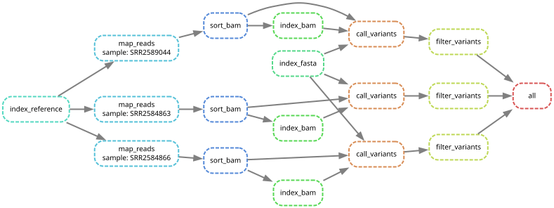

# Single-Nucleotide Variant (SNV) Calling in *E. coli* with Snakemake

## Workflow at a glance

<p align="center">
  
</p>

## Project overview 
We built a Snakemake workflow to detect single-nucleotide variants (SNVs) in three *E. coli* samples from generations 5,000, 15,000 and 50,000.
The workflow maps short sequencing reads to the ancestral REL606 reference genome, then calls and filters variants.   
Finally, it produces one filtered Variant Call Format (VCF) file per sample. 

## Motivation
We chose *E. coli* because it is a widely used **model organism** with a relatively **small genome**. It is **easy to grow** in the laboratory, and
its **short generation time** makes it well suited for studying genetic changes over many generations.

## Data sources and sample information

- **Sequencing reads** — We used trimmed and subsampled paired-end reads from the [Data Carpentry Genomics Curriculum Example Data](https://doi.org/10.6084/m9.figshare.7726454.v3).
- **Reference genome** — We used the ancestral *E. coli* B strain REL606 as our reference. Its GenBank accession is [CP000819.1](https://www.ncbi.nlm.nih.gov/nuccore/CP000819.1).
- **Original study** — The samples come from the *E. coli* Long-Term Evolution Experiment described by [Tenaillon et al. (2016)](https://doi.org/10.1038/nature18959).

### Input data

| Input | What it contains |
| --- | --- |
| Reference genome (FASTA) | The known genome sequence of the ancestral *E. coli* strain REL606. All three samples share this reference. |
| Sample reads (FASTQ) | Paired-end sequencing reads from each evolved sample, stored in two files per sample, one for R1 and one for R2. |

Paired-end sequencing reads each DNA fragment from both ends. The two reads from the same fragment form a read pair. For each sample, the `_1` FASTQ file contains all R1 reads, and the `_2` FASTQ file contains the corresponding R2 reads.  
In total, we used one reference FASTA file and six FASTQ files, with two FASTQ files per sample.


### SAMPLE TABLE: 

| Sequencing run ID | Clone | Generation |
| --- | --- | ---: |
| `SRR2589044` | `REL2181A` | 5,000 |
| `SRR2584863` | `REL7179B` | 15,000 |
| `SRR2584866` | `REL11365` | 50,000 |

## Installation

1. Install Conda if it is not already available.
2. From the project directory, create and activate the Conda environment. 

```Bash
conda env create -f environment.yml             
conda activate cas                          
```
The environment includes **Snakemake, BWA, SAMtools and BCFtools** for running the workflow. It also contains **Graphviz** for rendering the workflow diagram.

## Running the Workflow

### Prepare the input files
The input files are already included in `data/`. Follow the steps below only if you want to download them again.
From the project directory, create the input directories, then download and extract the paired-end reads.

```bash
mkdir -p data/reads data/reference
curl -fL -o data/sub.tar.gz https://ndownloader.figshare.com/files/14418248
tar -xzf data/sub.tar.gz -C data/reads --strip-components=1
```
Download the REL606 genome in FASTA format from the GenBank link in **Data sources and sample information.** Save the uncompressed file as `data/reference/REL606.fasta`.

### Preview and run the workflow
The file `config/config.yaml` defines the sample list, the number of mapping threads and the filtering thresholds. 

```Bash
snakemake -n -p             # Preview the jobs and print shell commands
snakemake --cores 1 -p      # Command that actually runs them; Run the workflow with one core and print the shell commands
```
The workflow writes one filtered VCF file per sample to `results/<sample>.snvs.vcf` and saves rule-specific logs in `logs/`.


## Workflow example
We added the 15,000-generation sample by placing its paired-end FASTQ files in `data/reads/` and adding `SRR2584863` to the `samples` list in `config/config.yaml`. The same rules processed the new sample.

```python
rule all:
    input:
        expand("results/{sample}.snvs.vcf", sample=config["samples"])
```
`expand()` generates one target filename per sample, such as `results/SRR2584863.snvs.vcf`. Snakemake then determines which rules need to run to produce those files.

## Variant filtering and results
We filtered the variants called by BCFtools before writing the final Variant Call Format (VCF) files.  
Thus, to be included in the final VCF file, a variant had to meet all three criteria below. 

- **Variant type (`TYPE="snp"`):** Keep only single-nucleotide substitutions.
- **Variant quality (`QUAL >= 20`):** Keep calls with a quality score of at least 20.
- **Read depth (`INFO/DP >= 5`):** Keep sites covered by at least five reads.

### Results:

We obtained the mapping statistics with `samtools flagstat`.

| Sample | Generation | Primary reads mapped | Properly paired reads | SNVs after filtering |
| --- | ---: | ---: | ---: | ---: |
| `SRR2589044` | 5,000 | 99.94% | 96.33% | 6 |
| `SRR2584863` | 15,000 | 99.96% | 98.03% | 18 |
| `SRR2584866` | 50,000 | 99.98% | 99.05% | 629 |
Among the three samples, the one from generation 50,000 had the highest number of detected SNVs relative to the REL606 reference genome.

The [example outputs](example-output/) include the filtered VCF files for all three samples and the corresponding Snakemake rule logs.

## Software versions

| Tool | Version used |
| --- | --- |
| Snakemake | 9.27.1 |
| BWA | 0.7.19-r1273 |
| SAMtools | 1.24 |
| BCFtools | 1.25 |
| Graphviz | 14.1.2 |

## Limitations
* We used trimmed and subsampled reads.
* Variants in regions with low read coverage may have been missed. 
* Each generation is represented by one clone, so the reported SNV counts describe those three clones.


